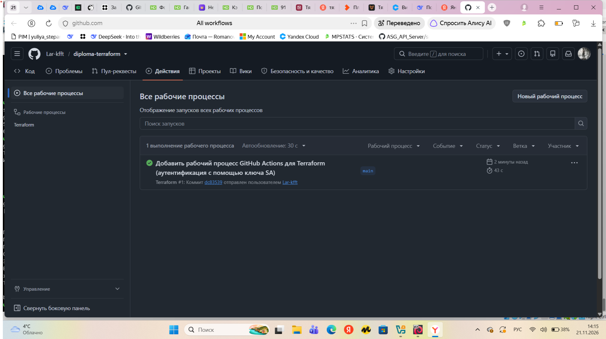
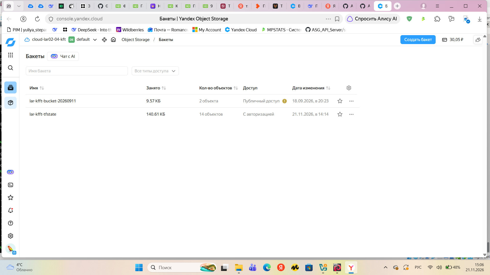
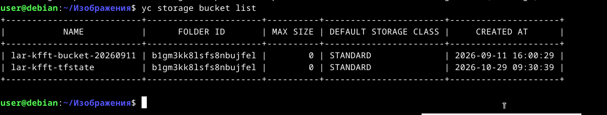

# diploma-terraform

Terraform-конфигурация инфраструктуры в Yandex Cloud для дипломного проекта.

## Состав
- `backend.tf` — remote backend в S3-бакете `lar-kfft-tfstate` (Yandex Object Storage).
- `main.tf` — VPC `diploma-network` + 3 подсети в зонах a/b/d, сервисные аккаунты, ВМ `k3s-node-yc` (Ubuntu 22.04, 2 vCPU / 4 ГиБ RAM, `ru-central1-d`).
- `k3s-cloud-init.yaml` — cloud-init для установки k3s.
- `.github/workflows/terraform.yml` — GitHub Actions: init → fmt → plan → apply на push в `main`.

## CI/CD

Секреты репозитория: `YC_SA_KEY`, `TF_STATE_ACCESS_KEY`, `TF_STATE_SECRET_KEY`, `YC_CLOUD_ID`, `YC_FOLDER_ID`, `TF_VAR_SSH_PUBLIC_KEY`.

Успешный прогон:

## Инфраструктура

## Особенности (РФ)
- Terraform и провайдеры — с зеркал Yandex Cloud.
- Аутентификация в CI — JSON-ключ сервисного аккаунта (не IAM-токен).
- State — в S3-бакете Yandex Object Storage.
